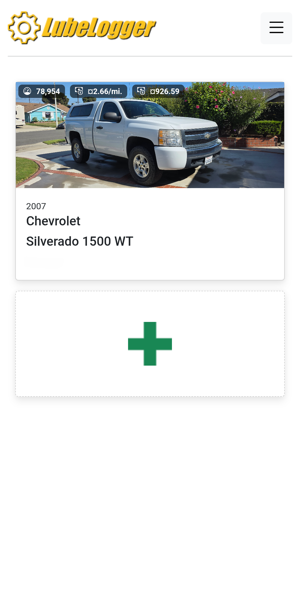
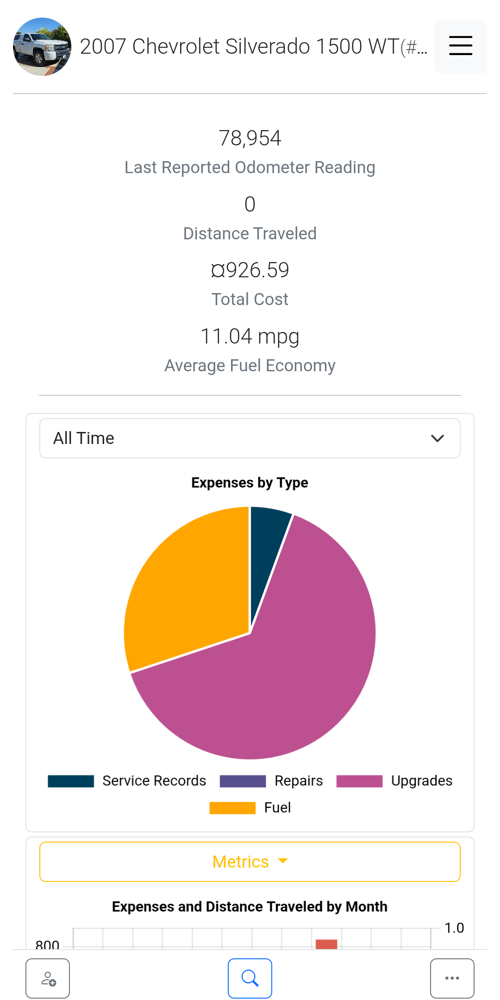

# LubeLogger-Android

A lightweight Android client for self-hosted [LubeLogger](https://github.com/hargata/lubelog) instances, built with Kotlin and Android WebView.

Originally created to make accessing my self-hosted vehicle maintenance records more convenient, this app provides a simple mobile experience with automatic server failover. It supports configurable primary and fallback URLs, allowing seamless access across local and remote networks.

## Download

The latest version is available through [GitHub Releases](https://github.com/AldogPlays/LubeLogger-Android/releases/latest).

## Screenshots

<table>
  <tr>
    <td align="center">
      <a href="home.png">
        
      </a>
      <br>
      <sub>Vehicle overview</sub>
    </td>
    <td align="center">
      <a href="vehicle-details.png">
        
      </a>
      <br>
      <sub>Vehicle statistics and maintenance records</sub>
    </td>
  </tr>
</table>

## Features

- **Automatic server failover** — Detects network changes and connection failures, switching between configured server addresses when necessary.
- **Flexible connectivity** — Supports LAN addresses, reverse proxies, and private overlay networks such as Tailscale.
- **Persistent configuration** — Stores preferred and fallback server URLs locally on the device.
- **Native Android integration** — Supports file and photo uploads, persistent cookies, Android back navigation, and system-bar insets.
- **Minimal dependencies** — Uses only the Android `INTERNET` permission, with no analytics, ads, Google Play Services, or third-party libraries.
- **GrapheneOS compatibility** — Works with GrapheneOS and the installed Android System WebView.

## How It Works

On first launch, the app prompts for a preferred server URL and an optional fallback URL.

Before connecting, it performs a short HTTP GET request to verify that the server responds successfully with recognizable LubeLogger HTML content.

The preferred server is checked first, followed by the fallback if necessary. If neither is available, the app presents options to retry the connection or reconfigure the server addresses.

While running, the app monitors network transitions and main-page connection failures. When connectivity changes, it validates the active server in the background and automatically switches to the configured fallback when needed.

## Security Considerations

- WebView navigation is restricted to the configured server origins.
- TLS certificate validation is enforced and never bypassed.
- Server configuration is stored locally on the device.
- No additional app-specific accounts, API keys, or external services are required.

**HTTP support:** Android's network security configuration cannot dynamically permit cleartext traffic for arbitrary user-provided hosts, so HTTP is enabled at the application level. Navigation remains restricted to user-configured origins.

HTTPS is strongly recommended whenever available, particularly when accessing an instance outside a trusted local network.

## Building

### Requirements

- JDK 17
- Android SDK 35

### Debug Build

Build the debug APK using Gradle:

```sh
./gradlew assembleDebug
```

The resulting APK will be located at:

```text
app/build/outputs/apk/debug/app-debug.apk
```

### Signed Release Build

Generate a private signing keystore (only required once):

```sh
keytool -genkeypair -v -keystore lubelogger-release.jks -alias lubelogger \
  -keyalg RSA -keysize 4096 -validity 10000
```

Build the release APK:

```sh
./gradlew assembleRelease
```

Align, sign, and verify the APK using Android build-tools:

```sh
zipalign -p -f 4 app/build/outputs/apk/release/app-release-unsigned.apk app-release-aligned.apk

apksigner sign --ks lubelogger-release.jks --out LubeLogger-release.apk app-release-aligned.apk

apksigner verify --verbose LubeLogger-release.apk
```

**Important:** Keep your signing keystore and credentials private. Never commit them to the repository, and maintain a secure backup. Future updates must be signed using the same signing key.
