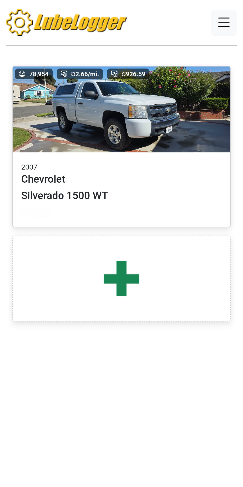
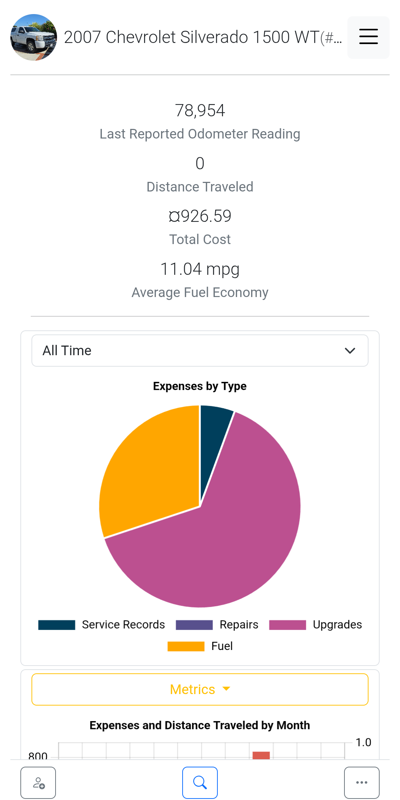

# LubeLogger-Android

A lightweight Android client for self-hosted [LubeLogger](https://github.com/hargata/lubelog) instances, built with Kotlin and Android WebView.

I built this to keep my vehicle maintenance records close at hand. It opens your own LubeLogger server in a dedicated app, with preferred and fallback addresses for use at home or away.

Requires Android 8.0 (API 26) or newer, Android System WebView, and your own LubeLogger server. No Google Play Services required.

Version 1.2.1 adds support for private CAs installed in Android settings, while preserving HTTPS certificate and hostname verification. It installs as **LubeLogger Client**, alongside the legacy LubeLogger app, because the legacy signing key is unavailable. Keep the old app installed to retain its settings and local data; configure the new app separately. See the [release notes](docs/release-notes-1.2.1.md) and [HTTPS and private CA guide](docs/HTTPS.md).

## Download

The latest version is available through [GitHub Releases](https://github.com/AldogPlays/LubeLogger-Android/releases/latest).

## Screenshots

Click a screenshot to view it larger.

<table>
  <tr>
    <td align="center">
      <a href="home.png">
        
      </a>
      <br>
      <sub>Vehicle overview</sub>
    </td>
    <td align="center">
      <a href="vehicle-details.png">
        
      </a>
      <br>
      <sub>Vehicle statistics and maintenance records</sub>
    </td>
  </tr>
</table>

## Features

- **Automatic server failover** — Detects network changes and connection failures, switching between configured server addresses when necessary.
- **Flexible connectivity** — Supports LAN addresses, reverse proxies, and private overlay networks such as Tailscale.
- **Persistent configuration** — Stores preferred and fallback server URLs locally on the device.
- **Native Android integration** — Supports file and photo uploads, persistent cookies, Android back navigation, and system-bar insets.
- **Minimal dependencies** — Requests Internet and network-state permissions, with no analytics, ads, Google Play Services, or third-party libraries.
- **GrapheneOS compatibility** — Works with GrapheneOS and the installed Android System WebView.

## Getting started

1. Install the APK from GitHub Releases and open **LubeLogger Client**.
2. Enter your preferred server URL and, optionally, a fallback address.
3. Connect and sign in to your LubeLogger server as usual.

## Connection behavior

On first launch, the app prompts for a preferred server URL and an optional fallback URL.

Before connecting, it performs a short HTTP GET request to verify that the server responds successfully with recognizable LubeLogger HTML content.

The preferred server is checked first, followed by the fallback if necessary. If neither is available, the app presents options to retry the connection or reconfigure the server addresses.

While running, the app monitors network transitions and main-page connection failures. When connectivity changes, it validates the active server in the background and automatically switches to the configured fallback when needed.

## Privacy and security

- WebView navigation is restricted to the configured server origins.
- TLS certificate validation is enforced and never bypassed.
- Native HTTPS checks and System WebView trust Android's system and user CA stores through Network Security Configuration. No private CA is bundled and no server address is hardcoded.
- Server configuration is stored locally on the device.
- No additional app-specific accounts, API keys, or external services are required.

**HTTP support:** Android's network security configuration cannot dynamically permit cleartext traffic for arbitrary user-provided hosts, so HTTP is enabled at the application level. Navigation remains restricted to user-configured origins.

HTTPS is strongly recommended whenever available, particularly when accessing an instance outside a trusted local network.

## Building

### Requirements

- JDK 17
- Android SDK 35

### Debug build

Build the debug APK using Gradle:

```sh
./gradlew assembleDebug
```

The resulting APK will be located at:

```text
app/build/outputs/apk/debug/app-debug.apk
```

### Signed release build

Use the retained LubeLogger Client release keystore for future updates. The [build and signing guide](docs/BUILDING.md) covers local checks, certificate continuity, signing, and backups. The new package preserves the legacy installation instead of attempting an incompatible update. Keep keystores and credentials outside the repository.

## Project

LubeLogger-Android is an independent wrapper, not an official LubeLogger application. Vehicle records and server authentication are handled by your LubeLogger instance.
